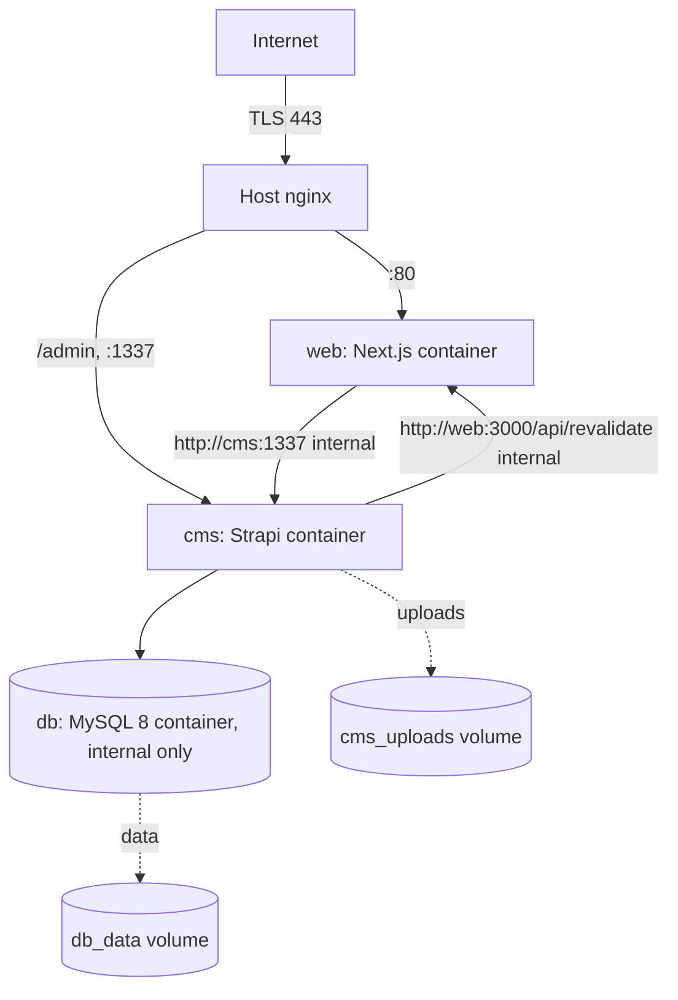
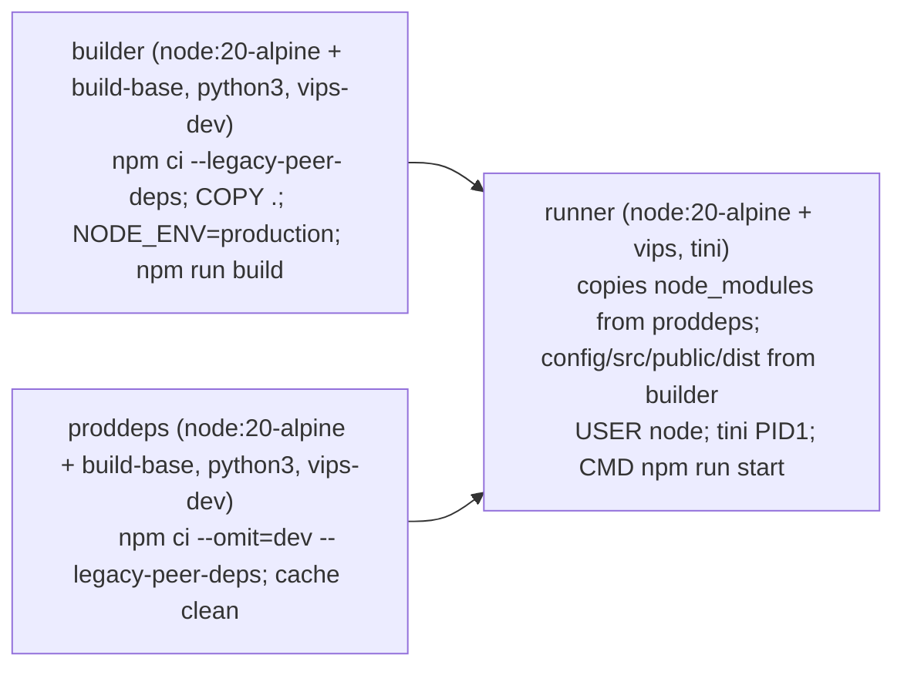

# Deployment & Build

> The authoritative production deployment: Dockerfile stages, the GHCR
> workflow, the on-server build fallback for the private package, RESEED deploy
> steps, and the revalidate webhook to the web app.
>
> Last reviewed: 2026-05-27 (commit 262ccc6)

## Contents

- [Production topology](#production-topology)
- [Dockerfile stages](#dockerfile-stages)
- [GHCR build workflow](#ghcr-build-workflow)
- [On-server build fallback (private package)](#on-server-build-fallback-private-package)
- [The compose stack](#the-compose-stack)
- [First-boot steps](#first-boot-steps)
- [Deploying an update](#deploying-an-update)
- [RESEED during deploy](#reseed-during-deploy)
- [The revalidate webhook](#the-revalidate-webhook)
- [Alternative: Render](#alternative-render)

## Production topology

Runs on a **Contabo VPS** at `/opt/inspire-africa` as a single `docker compose`
stack, behind the **host's nginx** (TLS termination). SSH is on port **2021**
with 2FA. The CMS admin is reachable at `inspireafricans.com/admin`.



- `db` MySQL 8 — internal only, no host port; named volume `db_data`.
- `cms` Strapi — publishes `1337`; uploads on named volume `cms_uploads`
  (`MEDIA_PROVIDER=local`).
- `web` Next.js — publishes `80` (mapped to container `3000`).
- The website talks to the CMS over the internal docker network
  (`http://cms:1337`); the CMS revalidates the site at `http://web:3000`.

> SHARED VPS — **never** run global `docker prune` / `docker compose down`
> across the host; only act on this stack's services. See
> [`operations.md`](./operations.md).

Source: website `deploy/docker-compose.yml`, `deploy/.env.production.example`,
deployment memory.

## Dockerfile stages

`Dockerfile` — three stages so the runtime ships production deps only:



- `builder` compiles the admin bundle + TS config (needs dev tooling).
- `proddeps` installs a pruned dependency tree.
- `runner` assembles a lean image, runs as non-root `node`, uses `tini` as PID 1
  for signal handling, ensures `/app/.tmp` + `/app/public/uploads` exist, and
  exposes `1337`. `vips` (libvips for `sharp`) is in the runtime.

## GHCR build workflow

`.github/workflows/deploy.yml` builds and pushes the image, then deploys it:

- Trigger: a **passed** `CI` run on a push to `main` (`workflow_run`), plus `workflow_dispatch`
  from `main`. A failing CI run never deploys.
- Builds + pushes `ghcr.io/cotetech-client-projects/inspire-africa-cms` with tags
  `sha-<short>` and `latest`, using the GHA build cache.
- A commit that only changes `docs/`, `*.md` or `render.yaml` is built and skipped. It does not deploy.

The image name changed from `ghcr.io/bahindiemma/inspire-africa-cms` (the old personal copy). That
older package is no longer published.

## On-server build fallback (private package)

The deploy logs in to GHCR with the workflow token, so the server needs no
standing GHCR login. Only if the pipeline is down and the image must be built on the host:

```bash
# On the VPS, from a checkout of inspire-africa-cms:
docker build -t ghcr.io/cotetech-client-projects/inspire-africa-cms:latest .
docker compose -f /opt/inspire-africa/docker-compose.yml up -d --no-deps cms
```

On-host builds need the same `vips`/`build-base` toolchain the Dockerfile
installs (handled inside the build stages).

## The compose stack

The compose file is `deploy/docker-compose.yml` in this repo. A deploy copies it to
`/opt/inspire-africa`. It runs the `db` and `cms` services. The website's `web` joins the same network. The `cms` service env (from
`/opt/inspire-africa/.env`) is documented in [`environment.md`](./environment.md).
Key CMS settings there: `DATABASE_CLIENT=mysql`, `DATABASE_HOST=db`,
`MEDIA_PROVIDER=local`, `IS_PROXIED=false`,
`FRONTEND_REVALIDATE_URL=http://web:3000/api/revalidate`, the analytics
secrets, and the Strapi secrets.

## First-boot steps

1. `docker compose up -d db` and wait for it to pass its healthcheck.
2. `docker compose up -d cms` — first boot creates schema + runs the four
   bootstrap seeders (roles, admin roles, public token, content). Watch logs
   for `[bootstrap] inspire-africa-cms is ready.`
3. Open `https://inspireafricans.com/admin` → create the **super-admin**.
4. Confirm Settings → Users & Permissions → Roles → Public has only
   `form-submission.create`.
5. Settings → API Tokens: a read-only `nextjs-public` token already exists
   (auto-seeded; plaintext was written once to `.runtime/public-api-token.txt`
   inside the container). Either read it from there or create a fresh one, then
   set it as `STRAPI_PUBLIC_TOKEN` in `/opt/inspire-africa/.env`.
6. `docker compose up -d web` to (re)start the site with the token.

## Deploying an update

Pushing to `main` deploys the CMS, once CI has passed on that commit. `deploy.yml` builds
the image, then `.github/actions/deploy` does the following on the server, in `/opt/inspire-africa`:

1. Logs in to GHCR with the workflow token and pulls `ghcr.io/cotetech-client-projects/inspire-africa-cms:sha-<short>`.
2. Dumps the database to `backups/cms-db-pre-deploy-<timestamp>.sql` (the last 14 are kept). An empty or failed dump stops the deploy before anything changes.
3. Copies `deploy/docker-compose.yml` from this repo over `/opt/inspire-africa/docker-compose.yml`. The previous file is kept as `docker-compose.previous.yml`.
4. Runs `CMS_IMAGE=<sha tag> docker compose up -d --no-deps cms`. Only the CMS container is recreated. `db`, `web` and the other projects on the host are not touched.
5. Waits for `http://127.0.0.1:1337/_health` to return 204. If it doesn't, the previous image and compose file are restored and the job fails.

The server's `.env` is never touched by a deploy. The GitHub side needs only the secret `SSH_KEY` and
the variables `VPS_HOST`, `VPS_USER` and optionally `VPS_PORT` (default `2021`), the same ones the
website repo uses.

**Migrations run on boot.** If the new image migrates the schema and then fails its health check,
the rollback puts back the old image, but the schema stays changed. Restore the dump from step 2 if
the old image then misbehaves (see [Database backup & restore](./operations.md#database-backup--restore)).

**Run compose from `/opt/inspire-africa` without `-f`, or use the same `CMS_IMAGE=...` prefix.**
The `cms` image defaults to `:latest`, which is also pushed on every deploy.

Manual deploy, if the pipeline is unavailable:

```bash
cd /opt/inspire-africa
docker compose pull cms && docker compose up -d --no-deps cms
```

## RESEED during deploy

Content updates that live in `seed-content.ts` are applied with a **one-shot**
`RESEED_CONTENT=true` boot, then removed. Full procedure + warnings:
[`seeding.md`](./seeding.md#running-a-reseed-safely).

```bash
RESEED_CONTENT=true docker compose up -d --force-recreate cms
docker compose logs -f cms | grep seed-content   # wait for "DONE."
docker compose up -d --force-recreate cms          # without RESEED_CONTENT
```

## The revalidate webhook

On every create/update/delete of a publishable type, the CMS POSTs
`{ collection, slug, uid }` to `FRONTEND_REVALIDATE_URL?secret=REVALIDATE_SECRET`
(`src/middlewares/revalidate-frontend.ts`). Revalidatable types: page,
blog-post, legal-document, job-posting, corridor, site-setting, design-token,
navigation, form-definition. The Next.js handler verifies the secret and calls
`revalidateTag`/`revalidatePath`. In production this is an **internal** call
(`http://web:3000/api/revalidate`), so it never leaves the docker network.
Failures are logged and non-fatal. Frontend handler details:
[`frontend-integration.md`](./frontend-integration.md).

## Alternative: Render

A `render.yaml` blueprint is included for a Render-hosted deployment with an
external managed MySQL (or Render Postgres). It is **not** the production path
but remains a valid alternative scaffold. The pre-existing
[`docs/deployment.md` history / `api-contract.md`] describe that Render/AWS
reference architecture; for the live environment, this document is
authoritative.
